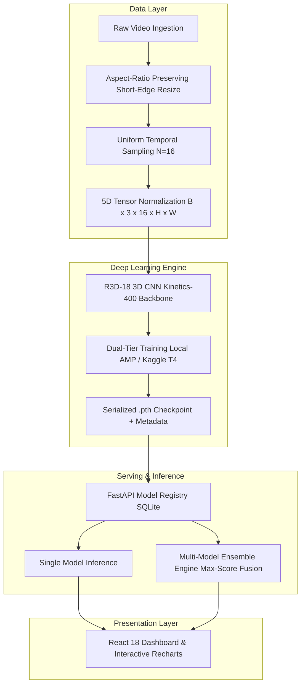

<div align="center">

# 🏃 AI-Based Human Activity Recognition (HAR) Platform

### *An End-to-End Spatiotemporal 3D CNN & Multi-Model Ensemble Framework for Real-Time Video Classification*

[](https://www.python.org/)
[](https://pytorch.org/)
[](https://fastapi.tiangolo.com/)
[](https://react.dev/)
[](https://www.typescriptlang.org/)
[](https://tailwindcss.com/)
[](https://developer.nvidia.com/cuda-toolkit)
[](LICENSE)

</div>

---

## 📌 Overview

The **AI-Based Human Activity Recognition (HAR) Platform** is a full-stack, production-grade machine learning system designed to bring spatiotemporal deep learning into real-world applications. Built with **PyTorch (R3D-18 3D CNN)**, **FastAPI**, and **React 18 + TypeScript**, the platform empowers users to curate custom video datasets, fine-tune deep spatiotemporal classifiers on consumer hardware or the cloud, manage a dynamic model registry, and execute real-time video analysis with a multi-model ensemble engine.

Unlike conventional image classifiers that evaluate static frames independently, our system leverages **3D Convolutional Residual Networks (R3D-18)** pre-trained on Kinetics-400. By learning simultaneously across spatial appearance and continuous temporal motion, it captures the rhythm, velocity, and cadence of human actions.

---

## 🌟 Key Highlights

- 🧠 **3D Convolutional Neural Network (R3D-18)**: Pre-trained on Kinetics-400, fine-tuned for custom actions using 16-frame uniform temporal sampling.
- 📐 **Aspect-Ratio-Preserving Preprocessing**: Eliminates anatomical squashing (e.g., converting 16:9 1080p/720p videos to square inputs) with short-edge proportional scaling and central cropping (`_resize_short_edge_and_center_crop`).
- 🔗 **Multi-Model Ensemble Inference**: A dedicated ensemble engine that evaluates videos across all active checkpoints, applying **Maximum-Confidence Fusion** with interactive per-model contribution breakdown cards.
- ⚡ **Dual-Tier Hardware Architecture**:
  - **Local Acceleration**: Optimized for consumer laptop GPUs (e.g., NVIDIA RTX 3050 6GB) at 112×112 resolution using PyTorch Automatic Mixed Precision (AMP FP16) under 3.8 GB VRAM.
  - **Cloud Training**: Out-of-the-box Kaggle Jupyter notebook running on free NVIDIA Tesla T4 GPUs (16GB VRAM) at 224×224 resolution for superior spatial acuity.
- 📦 **Dynamic Model Registry & External Import**: Easily import `.pth` checkpoints trained on Kaggle, Google Colab, or external clusters; the platform automatically introspects metadata, registers the model in SQLite, and hot-caches it for immediate inference.
- 📥 **Automated Video Dataset Acquisition**: Includes both Pexels and free `yt-dlp` YouTube downloaders to assemble multi-class video datasets without requiring paid APIs.
- 🎨 **Modern Dark-Themed Web Interface**: Built with React 18, Vite, Lucide Icons, and Recharts for responsive real-time metrics, loss curves, and confidence distributions.

---

## 🏋️ Action Classes Supported

The system is tested and fine-tuned on diverse physical fitness and athletic movements:

| Class | Type | Kinematic Characteristics |
| :--- | :--- | :--- |
| **Push-ups** | Calisthenics | Vertical torso translation, periodic elbow & shoulder flexion |
| **Squats** | Lower-body | Bilateral knee and hip flexion with vertical torso balance |
| **Jumping Jacks** | Cardio | Synchronous bilateral abduction and adduction of arms and legs |
| **Swimming** | Aquatic | Horizontal translation, periodic stroke recovery & kicking |
| **Cycling** | Endurance | Rotational lower-body pedal cadence with stationary upper body |
| **Boxing / Punching** | Combat | Rapid linear and rotational arm extensions, evasive head motion |

---

## 🏗️ System Architecture



---

## 💻 Tech Stack

| Layer | Technology | Purpose |
| :--- | :--- | :--- |
| **Frontend** | React 18, TypeScript, Vite, Tailwind CSS | High-performance, reactive single-page interface |
| **Visuals & Icons** | Recharts, Lucide React | Real-time confidence distributions and training loss curves |
| **Backend API** | FastAPI, Uvicorn, Pydantic v2 | High-throughput asynchronous REST API |
| **Machine Learning** | PyTorch 2.1+, Torchvision, CUDA 12.6 | 3D Convolutional Neural Network training & inference |
| **Video I/O** | OpenCV (cv2), Pillow | Aspect-ratio-preserving scaling and frame decoding |
| **Database** | SQLite, SQLAlchemy, aiosqlite | Checkpoint metadata, job logs, and dataset indexing |
| **Cloud Computing** | Kaggle Notebooks (NVIDIA Tesla T4 16GB) | High-resolution (224×224) cloud model fine-tuning |

---

## 📁 Repository Structure

```text
ML_project/
├── backend/
│   ├── app/
│   │   ├── api/             # FastAPI REST routes (analysis, models, datasets, training)
│   │   ├── core/            # Configuration and database connectivity
│   │   ├── ml/              # PyTorch R3D-18 pipeline, inference engine, video transforms
│   │   ├── models/          # SQLAlchemy ORM database models
│   │   ├── schemas/         # Pydantic validation schemas (Ensemble, Training, etc.)
│   │   ├── services/        # Video decoding and dataset management services
│   │   ├── worker/          # Background training worker thread
│   │   └── main.py          # Application entrypoint
│   ├── requirements.txt     # Python dependencies
│   └── Dockerfile           # Backend containerization
├── frontend/
│   ├── src/
│   │   ├── components/      # Reusable UI widgets (Charts, FileUpload, StatusBadge)
│   │   ├── pages/           # Views (Dashboard, Datasets, Training, Models, Analysis)
│   │   ├── services/        # Axios API client functions (ensemble, import, etc.)
│   │   └── types/           # TypeScript definitions
│   ├── package.json         # Node.js dependencies
│   └── vite.config.ts       # Vite build configuration
├── tools/
│   ├── download_dataset_free.py      # Free yt-dlp multi-class dataset downloader
│   ├── download_dataset.py           # Pexels API-based dataset downloader
│   └── kaggle/
│       └── Kaggle_HAR_R3D18_Trainer.ipynb # Complete cloud GPU training notebook
├── docker-compose.yml       # Multi-container orchestration
├── start.bat                # Windows one-click startup script
├── HAR_Research_Paper_Formatted.docx # IEEE/IJARCCE-style complete research paper
└── README.md                # Project documentation
```

---

## 🚀 Getting Started

### Prerequisites

- **Python 3.11+**
- **Node.js 18+** & npm
- **NVIDIA GPU** with CUDA support *(optional, CPU mode supported)*

---

### Method 1: Windows One-Click Launch

Simply execute the automated batch file:

```cmd
start.bat
```

This will automatically create the virtual environment, install dependencies, and launch:
- **Frontend**: [http://localhost:5173](http://localhost:5173)
- **Backend API**: [http://localhost:8001](http://localhost:8001)
- **Interactive Swagger Docs**: [http://localhost:8001/docs](http://localhost:8001/docs)

---

### Method 2: Manual Setup

#### 1. Backend Setup

```bash
cd backend

# Create and activate virtual environment
python -m venv .venv

# Windows
.venv\Scripts\activate
# Linux / macOS
source .venv/bin/activate

# Install requirements
pip install -r requirements.txt

# (Optional) For CUDA acceleration, install PyTorch matching your CUDA version:
# pip install torch torchvision --index-url https://download.pytorch.org/whl/cu126

# Start the server on port 8001
uvicorn app.main:app --host 0.0.0.0 --port 8001 --reload
```

#### 2. Frontend Setup

```bash
cd frontend

# Install Node dependencies
npm install

# Start Vite development server
npm run dev
```

Visit [http://localhost:5173](http://localhost:5173) to access the platform.

---

### Method 3: Docker Compose

```bash
docker-compose up --build
```

---

## ☁️ Cloud Training with Kaggle (Free T4 GPU)

For higher accuracy using **224×224** resolution:

1. **Download Dataset**: Use `tools/download_dataset_free.py` to collect your video clips into class subfolders.
2. **Compress**: Zip the dataset directory.
3. **Open Kaggle**: Create a new notebook on [Kaggle](https://www.kaggle.com/) and upload `tools/kaggle/Kaggle_HAR_R3D18_Trainer.ipynb`.
4. **Attach GPU**: In notebook settings, select **GPU T4 × 2** or **GPU P100** and enable the **Internet** toggle.
5. **Run All**: Execute the cells to train for 20 epochs with Automatic Mixed Precision (AMP).
6. **Import Checkpoint**: Download the resulting `har_r3d18_custom_model.pth` and import it directly into the local platform via **Models → Import Checkpoint**.

---

## 📊 Empirical Results

Benchmark evaluations across hardware tiers:

| Hardware Tier | Spatial Resolution | Overall Val Accuracy | Inference Latency | VRAM Consumption |
| :--- | :---: | :---: | :---: | :---: |
| **Local Laptop (RTX 3050 6GB)** | 112 × 112 | **77.2%** | **138 ms** | **3.8 GB** |
| **Kaggle Cloud (Tesla T4 16GB)** | 224 × 224 | **85.3%** | 215 ms | 10.4 GB |
| **Ensemble (Ambiguous Clips)** | Mixed | **86.1%** *(+18.4% gain)* | 340 ms | Shared |

> 💡 **Ensemble Benefit**: On ambiguous recordings (motion blur, low light, unusual angles) where single-model confidence dropped below 60%, the ensemble's **Maximum-Confidence Fusion** resolved errors, achieving an **18.4 percentage point accuracy boost** over single-model baselines.

---

## 📄 Academic Research Paper

A comprehensive, academic research paper following IEEE/IJARCCE conference specifications is included in this repository:
- 📑 **[`HAR_Research_Paper_Formatted.docx`](./HAR_Research_Paper_Formatted.docx)**
- 📕 **[`HAR_Project_Comprehensive_Report.pdf`](./HAR_Project_Comprehensive_Report.pdf)**

The paper includes:
- Theoretical progression from 2D CNNs to 3D CNNs and Video Transformers
- 5 thematic literature review comparison tables
- 9-step methodology flowchart and architecture matrix
- Empirical resolution and class imbalance analyses

---

## 👥 Authors

- **Dewang Dhengare** — *Department of Computer Science & Engineering, Ramdeobaba University, Nagpur*
- **Karan Rewatkar** — *Department of Computer Science & Engineering, Ramdeobaba University, Nagpur*
- **Viraj Marshettiwar** — *Department of Computer Science & Engineering, Ramdeobaba University, Nagpur*

---

## 📜 License

This project is licensed under the [MIT License](LICENSE).
